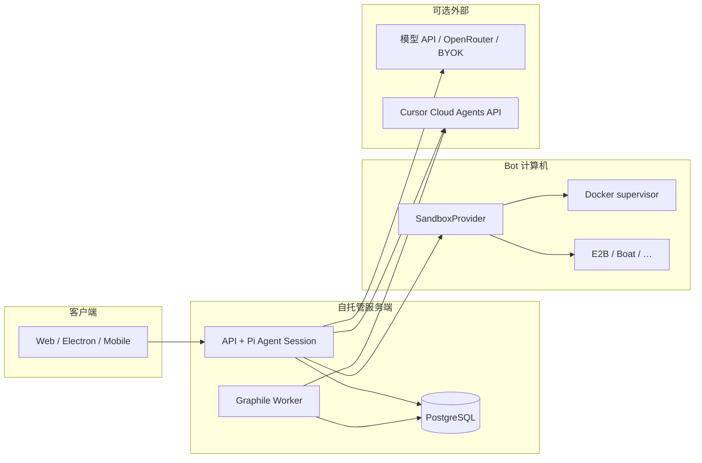

# Matebot 二次开发计划

> **仓库**：[Lizer2009/matebot](https://github.com/Lizer2009/matebot)（fork 自 [elie222/rakazo](https://github.com/elie222/rakazo)）  
> **目标**：把 matebot 作为**第二个 Grok Bot 实例**，在**不依赖本地电脑**的前提下，通过 Cursor Cloud Agent / 云端 VPS 完成在线迭代。  
> **本文档性质**：规划稿（Planning pass）。实现工作按文末 P0/P1/P2 分阶段进行。  
> **验证日期**：2026-11-04 — fork `main` 在合并部署文档 PR 后为 `5480b877`，upstream `main` 为 `d97c5fd7`（见 [MATEBOT_DEPLOY.md](./MATEBOT_DEPLOY.md#跟踪-commit2026-11-04-自本仓库观测)）。**部署路径已定为 VPS/LAN Compose（192.168.10.12）；Railway 暂缓。** P1-5 **轻量品牌**：几何 Matebot 图标、favicon/PWA、`PRODUCT_DISPLAY_NAME`、`docs/MATEBOT_BRAND.md`（PR #3）；包名与 GHCR 默认值仍为 upstream 形态。

---

## 1. 执行摘要

| 维度 | 结论 |
| --- | --- |
| 与 upstream 关系 | 当前与 `elie222/rakazo` **字节级一致**；所有 `@rakazo/*` 包名、GHCR 镜像、`rakazo.com` 文档链接仍指向上游。 |
| 推荐部署形态（无本地机） | **Matebot 当前：VPS + Compose 镜像**（`192.168.10.12`）；**Railway 暂缓**。Bot **计算机**可用 Docker（有 socket）或 **E2B / Boat / Daytona** 等远程沙箱。 |
| Cursor 集成 | 产品已内置 **Cursor Cloud Agent** 适配器（`CLOUD_AGENT_PROVIDER=cursor`）；Bot 可通过 `cloud_agent_*` 工具在**你的 GitHub 仓库**上启动 Cursor 云端 Agent，与「在 Cursor 里改 matebot 代码」是**互补**关系。 |
| 首轮编码重点 | 分叉标识（可选）、**自有 GHCR/安装脚本默认值**、**matebot 专用 `.env` 模板**、CI 可绿、文档与 upstream 同步策略。 |

---

## 2. 仓库形态与架构

### 2.1 Monorepo 布局

```
matebot/                          # 根 package: rakazo@0.1.0（待品牌化）
├── apps/
│   ├── api/          @rakazo/api      Hono + oRPC，HTTP/WebSocket，Pi agent 运行时宿主
│   ├── worker/       @rakazo/worker    Graphile Worker：定时任务、cloud agent 轮询、恢复
│   ├── web/          @rakazo/web       Vite + React 19 主 UI（自托管与 app.rakazo.com 同源代码）
│   ├── desktop/      @rakazo/desktop   Electron 壳（托管本地 Docker 栈或连接远程实例）
│   ├── mobile/       @rakazo/mobile    Expo Router 原生客户端
│   └── www/          @rakazo/www       Astro 营销站（可单独部署，规则较松）
├── packages/
│   ├── core/         共享领域逻辑、工具
│   ├── contracts/    API/事件类型契约
│   ├── db/           Prisma + PostgreSQL
│   ├── adapters/     沙箱、模型、集成、**cursor-cloud-agent** 等所有外部边界
│   ├── adapter-kit/  适配器接口（CloudAgentProvider、SandboxProvider…）
│   ├── auth/         Better Auth
│   ├── memory/       记忆抽象
│   ├── chat-ui/      聊天 UI 片段
│   ├── ui-web/       shadcn/Base UI 组件
│   ├── ui-tokens/    设计 token
│   └── testkit/      集成/E2E/评测 CLI
└── infra/
    ├── compose/      Docker Compose、install-images.sh、生产 Caddy 栈
    ├── sandboxes/    computer / supervisor 镜像定义
    ├── railway/      Railway 模板说明
    └── updater/      桌面端「应用内更新」Compose 逻辑
```

**pnpm workspace**（`pnpm-workspace.yaml`）：`apps/*`、`packages/*`，外加 `infra/sandboxes/supervisor` 与 `infra/updater`。

### 2.2 运行时数据流（简化）



要点（详见 [`docs/computer-runtime.md`](./computer-runtime.md)、[`docs/run-execution.md`](./run-execution.md)）：

- **Pi** 跑在 API/worker 进程内，**不在** E2B/计算机容器里。
- **Run** 在 API 内即时启动；worker 负责恢复、cloud agent 轮询、Graphile 维护任务。
- **SandboxProvider** 是计算机边界：生命周期、桌面、shell、文件、浏览器工具。

### 2.3 模型与集成边界

- 部署级默认：`PI_DEFAULT_PROVIDER` / `PI_DEFAULT_MODEL`（见 [`docs/self-host-models.md`](./self-host-models.md)）。
- 用户可在 UI 连接自有模型（OpenRouter、Anthropic、Copilot、SuperGrok 等）。
- 供应商名称与 SDK **仅出现在 adapters**；共享契约与 UI 保持供应商中立（[`AGENTS.md`](../AGENTS.md)）。

### 2.4 Cursor Cloud Agent（产品内）

配置（API + worker **相同**环境变量，见 [`docs/self-host-integrations.md`](./self-host-integrations.md#enable-cursor)）：

```dotenv
CLOUD_AGENT_PROVIDER=cursor
CLOUD_AGENT_SPACE_ID=<你的 Space ID>
CURSOR_API_KEY=<API Key>
```

Bot 工具：`cloud_agent_launch` / `status` / `reply` / `cancel`。用于把**仓库任务**委托给 Cursor 托管 Agent，并在聊天里跟踪 PR 链接——适合「用 matebot 指挥 Cursor 改 matebot」的闭环。

开发/CI 可用 `CLOUD_AGENT_PROVIDER=emulator`（进程内模拟 Cursor HTTP，无网络）。

---

## 3. 在线运行与部署（无本地电脑）

### 3.1 路径对比

| 路径 | 是否需要本地机 | 计算机能力 | 适合 matebot 迭代 |
| --- | --- | --- | --- |
| **Railway 模板** | 否 | Railway 托管 sandbox | ★★★ 个人第二实例最快 |
| **VPS + `install-images.sh`** | 否（仅 SSH 到 VPS） | 默认 Docker；可改 E2B/Boat | ★★★ 可控、可 HTTPS |
| **继续拉 upstream GHCR 镜像** | 否 | 同左 | ★★ 零构建，但镜像仍是 upstream |
| **Fork 自建 GHCR + 改 `RAKAZO_IMAGE`** | 否（CI 构建） | 同左 | ★★★ 长期独立发布 |
| **`pnpm dev` 源码开发** | **是**（Node 22+、pnpm、Docker） | 本地 Docker computer | ★ 仅适合有本机时 |
| **Electron「本机计算机」** | **是** | 宿主 OS | ✗ 不符合「无本地机」 |
| **Expo 移动构建 / 桌面签名发布** | **是**（macOS 等） | N/A | ✗ 非在线迭代必需 |

### 3.2 推荐：Railway（零 Docker 运维）

- 文档：[`infra/railway/README.md`](../infra/railway/README.md)
- 特点：单用户、`OWNER_EMAIL` / `OWNER_PASSWORD` 引导；Postgres 与 `/data` 卷；计算机在**独立 Railway 环境**。
- 限制：需 Railway Pro 才享托管卷备份；**模板仍指向上游镜像源**（fork 后若要固定镜像需改模板或变量）。

### 3.3 推荐：VPS + 发布镜像 Compose

```bash
mkdir -p matebot && cd matebot
curl -fsSLO https://raw.githubusercontent.com/elie222/rakazo/main/infra/compose/install-images.sh
bash install-images.sh --prepare-only
# 编辑 .env：RAKAZO_HOST、HTTPS 三件套、模型密钥、SANDBOX_PROVIDER=boat|e2b|…
bash install-images.sh
```

**无本地电脑时的关键选择**：

1. **`SANDBOX_PROVIDER`**：在纯 PaaS（无 Docker socket）上不要用 `docker`；改用 `e2b`、`boat`、`daytona`、`createos` 等并配置对应 API key（[`docs/self-host-sandbox-providers.md`](./self-host-sandbox-providers.md)）。
2. **`SANDBOX_PROVIDER=none`**：仅聊天/集成、不要 Bot 桌面时可用；Compose 仍要求 `SANDBOX_SUPERVISOR_TOKEN`（见文档）。
3. **HTTPS**：公网访问必须设置 `BETTER_AUTH_URL`、`WEB_ORIGIN`、`API_URL`、`RAKAZO_HOST`（[`docs/self-host-production.md`](./self-host-production.md)）。

### 3.4 Fork 镜像与安装脚本（中期必做）

当前默认值指向上游：

- 应用镜像：`ghcr.io/elie222/rakazo/app:edge`
- 计算机镜像：`ghcr.io/elie222/rakazo/computer:edge`
- 安装脚本下载基址：`RAKAZO_DOWNLOAD_BASE=https://raw.githubusercontent.com/elie222/rakazo/main/infra/compose`

**Matebot 独立迭代**应：

1. 在 `Lizer2009/matebot` 启用 GitHub Actions **`publish-server-image`**（fork 上会在 GitHub runner 构建，无 Depot 变量时仍可用）。
2. 发布到 **`ghcr.io/lizer2009/matebot/app`**（命名示例，需与 GHCR 权限一致）或在 `.env` 用 `RAKAZO_IMAGE` 覆盖。
3. ~~提供 **`infra/compose/install-images-matebot.sh`**~~ — **已完成（2026-11-04）**：[`install-images-matebot.sh`](../infra/compose/install-images-matebot.sh) + [`MATEBOT_DEPLOY.md`](./MATEBOT_DEPLOY.md)。

### 3.5 Cursor Cloud Agent 开发环境（改代码）

在 **Cursor 云端 Agent** 里改 matebot 源码时：

| 能力 | Cloud Agent 可做 | 需要本地 / 特殊环境 |
| --- | --- | --- |
| 读代码、改 TS、开 PR | ✅ | — |
| `pnpm install` / `pnpm test`（单元/大部分 vitest） | ✅ | — |
| `pnpm build` | ✅（CI 同款 env vars） | — |
| 集成测试 / Testcontainers | ⚠️ 视 runner Docker 而定 | 部分 job 需 Docker |
| `pnpm dev` 全栈 + 浏览器手测 | ⚠️ 需 tmux + 端口 | 无持久公网 URL 时仅 loopback |
| `pnpm sandbox:build`、Compose 全栈 | ⚠️ 需 Docker | Cloud Agent VM 通常有 Docker |
| Electron E2E（偷焦点） | ❌ 不在 cloud 常规跑 | CI `xvfb` 或 maintainer 本机 |
| iOS/Android 截图发布 | ❌ | macOS / 模拟器 |
| 部署 matebot 到 Railway/VPS | ✅（凭据在 secrets） | 凭据需用户配置 |
| 在**已部署 matebot** 里启用 Cursor 工具 | ✅ | 在服务器 `.env` 配 `CURSOR_*` |

建议在 fork 根目录增加 **`.cursor/environment.json`**（或 Cursor 仪表盘 Environment）：`install` 用 `pnpm install --frozen-lockfile`，`start` 可选 `pnpm dev` 或仅文档说明「在线实例在 Railway/VPS」。

---

## 4. 与 upstream 同步策略

### 4.1 原则

- Rakazo 活跃度高（fork 验证日 upstream 与 fork 同 SHA）。**长期分叉代码**会抬高合并成本。
- 建议：**应用层/custom 尽量薄**——品牌化、默认 env、部署脚本、文档；核心逻辑 **rebase/merge upstream `main`**。

### 4.2 推荐 Git 工作流

```bash
git remote add upstream https://github.com/elie222/rakazo.git
git fetch upstream
git checkout main
git merge upstream/main   # 或 git rebase upstream/main（团队习惯 rebase 时）
```

- **跟踪分支**：`main` 跟踪 `origin/main`，定期 merge upstream。
- **冲突热点**：`pnpm-lock.yaml`、Prisma migrations、`infra/compose/*`、`.github/workflows/*`。
- **不要**在未协调的情况下改 `@rakazo/*` 包名（牵涉全 monorepo + 移动客户端 bundle id）。

### 4.3 风险

| 风险 | 影响 | 缓解 |
| --- | --- | --- |
| Schema 迁移与「上一版本仍运行」规则 | 部署失败或数据不一致 | 严格按 [`AGENTS.md`](../AGENTS.md) 迁移规范；先读 upstream release notes |
| GHCR 仍指 upstream | 运行的不是 fork 代码 | 自建镜像或明确 pin digest |
| 双实例共用同一 Cursor Space / 同一 Bot 密钥 | 串单、越权 | matebot 独立 Space、`CLOUD_AGENT_SPACE_ID`、独立 DB |
| Railway/Stripe/Slack 等模板默认值 | 指向 rakazo 官方 | fork 文档与 env 示例改为 matebot |
| 许可证与商标 | README/商店仍写 Rakazo | 合规改名：保留 Apache-2.0 声明，区分**产品名**与**上游致谢** |

---

## 5. Matebot 定位与里程碑

### 5.1 产品定位（建议）

- **实例 B**：与现有 Grok Bot / app.rakazo.com **并行**，独立 Postgres、独立模型配额、独立集成密钥。
- **迭代方式**：Cursor Cloud Agent 对 **Lizer2009/matebot** 开 PR → CI 绿 → 部署到 Railway/VPS → 在 UI 里验证 Bot 行为。
- **可选**：matebot 上的 Bot 配置 `cloud_agent_launch` 指回同一 GitHub org，形成「Bot 提需求 → Cursor Agent 实现」。

### 5.2 里程碑 M0–M3

| 阶段 | 名称 | 交付物 |
| --- | --- | --- |
| **M0** | 规划冻结 | 本文档 + PR 合并；✅ 部署目标：**VPS/LAN Compose**（Railway 暂缓，2026-11-04） |
| **M1** | 可部署分叉 | fork GHCR 或文档化 `RAKAZO_IMAGE`；matebot 安装说明；**一处**在线实例可登录 |
| **M2** | 迭代闭环 | `.cursor/environment.json`；CI 绿；默认 `CLOUD_AGENT_*` 文档；Bot 能 `cloud_agent_launch` 到 matebot 仓库 |
| **M3** | 差异化（可选） | 默认模型/审批策略、关闭不需要的集成、自定义 www 落地页 |

---

## 6. 优先级 backlog（接下来 1–2 轮编码）

### P0 — 必须先做

| ID | 项 | 验收标准 |
| --- | --- | --- |
| P0-1 | **确认部署目标并记录** | ✅ 2026-11-04 — [MATEBOT_DEPLOY.md](./MATEBOT_DEPLOY.md)：VPS/LAN Compose；Railway 暂缓；secrets 清单 |
| P0-2 | **在线实例跑起来** | HTTPS URL 可注册/登录；至少一个 Bot 能完成一轮对话（已接模型） |
| P0-3 | **远程计算机** | 在目标环境 `SANDBOX_PROVIDER≠docker`（若 host 无 socket）且 Bot 能执行简单 `shell` 或明确文档「仅 none」 |
| P0-4 | **CI 在 fork 上通过** | ✅ 2026-11-04 — fork 回退 `ubuntu-latest` runner；Vercel 失败文档化（[MATEBOT_DEPLOY.md](./MATEBOT_DEPLOY.md#fork-ci-说明)） |
| P0-5 | **Upstream 远程** | ✅ 2026-11-04 — [MATEBOT_DEPLOY.md §Git](./MATEBOT_DEPLOY.md#与-upstream-同步git) + 跟踪 SHA |

### P1 — 第二轮

| ID | 项 | 验收标准 |
| --- | --- | --- |
| P1-1 | **自有容器镜像** | ✅ **2026-11-04** — `publish-server-image` 推送到 `ghcr.io/lizer2009/matebot/{app,computer,updater}`；见 [`MATEBOT_DEPLOY.md`](./MATEBOT_DEPLOY.md) 与 `.env.images.matebot.example` |
| P1-2 | **install 脚本分叉** | ✅ **2026-11-04** — `install-images-matebot.sh` 默认 fork raw + matebot env 模板；`install-images-matebot.smoke.sh` 与既有 compose smokes 通过 |
| P1-3 | **Cursor 开发环境** | ✅ 2026-11-04 — [`.cursor/environment.json`](../.cursor/environment.json) + [MATEBOT_CURSOR.md](./MATEBOT_CURSOR.md) |
| P1-4 | **启用 Cursor 集成** | 部署 env 含 `CLOUD_AGENT_PROVIDER=cursor`；Bot 成功 launch 一次 emulator 或真实 agent（staging） |
| P1-5 | **轻量品牌** | ✅ 2026-11-04 — README / README.zh-CN 顶部（链计划/部署/Cursor/品牌）；几何 Matebot 图标与 Web/PWA/Linux·Windows favicon；`PRODUCT_DISPLAY_NAME`；**未**改 `@rakazo/*` |

### P2 — 后续

| ID | 项 | 验收标准 |
| --- | --- | --- |
| P2-1 | 默认模型/审批模板（matebot 专用 `.env.matebot.example`） | 新部署复制即用 |
| P2-2 | Railway template fork | 一键按钮指向 matebot 镜像与环境 |
| P2-3 | 自动化 upstream sync PR（weekly workflow 可选） | 打开 PR 而非直接 push |
| P2-4 | 独立 Astro/www 或关闭 www 构建 | 减少与 rakazo.com 混淆 |
| P2-5 | 全包 rename `@rakazo` → `@matebot` | 仅当有商店/客户端发布需求时评估（成本高） |

---

## 7. 品牌化与配置：建议「改什么、暂不改什么」

### 7.1 早期建议改

- GitHub repo 描述、About、Social preview
- `README.md` / `README.zh-CN.md` 顶部 matebot 说明与**自托管 URL**
- `.env.example` 注释中的示例域名
- Compose 安装默认 download base（fork 专用脚本或 env）
- GitHub Actions：GHCR `IMAGE_NAME` 前缀（workflow 内变量或 fork 文档）

### 7.2 建议暂缓

- npm 包名 `@rakazo/*`（除非准备改 mobile bundle id、Electron `productName`、数据库角色名 `rakazo_app` 等连锁变更）
- 删除 upstream 致谢与 Apache-2.0 归属
- 大规模 UI 文案替换（工作量大、merge 冲突多）

---

## 8. 安全与运维清单（matebot 实例）

- [ ] 独立 `ENCRYPTION_KEY`、`BETTER_AUTH_SECRET`、Postgres 密码（**勿**与生产 Grok Bot 复用）
- [ ] 公网：`SIGNUPS_ENABLED` 策略、`RAKAZO_ADMIN_EMAILS`、TLS
- [ ] Cursor：`CURSOR_API_KEY` 仅服务器 env；Space 与仓库权限最小化
- [ ] 备份：Postgres + `DATA_DIR`（Railway 卷或 VPS 定时任务），见 [`docs/self-host-backups.md`](./self-host-backups.md)
- [ ] 升级：先读 [`docs/self-host-upgrading.md`](./self-host-upgrading.md)；迁移兼容上一版本代码

---

## 9. 参考文档索引

| 主题 | 文档 |
| --- | --- |
| Matebot 部署 / Cursor / 计划 | [`MATEBOT_DEPLOY.md`](./MATEBOT_DEPLOY.md)、[`MATEBOT_CURSOR.md`](./MATEBOT_CURSOR.md)、本文 |
| 自托管总览 | [`docs/self-host.md`](./self-host.md) |
| 生产 HTTPS | [`docs/self-host-production.md`](./self-host-production.md) |
| 模型 | [`docs/self-host-models.md`](./self-host-models.md) |
| 沙箱/计算机 | [`docs/self-host-sandbox-providers.md`](./self-host-sandbox-providers.md) |
| Cursor Cloud Agent | [`docs/self-host-integrations.md`](./self-host-integrations.md) |
| Agent 安装提示词 | [`SETUP_PROMPT.md`](../SETUP_PROMPT.md) |
| 贡献/Agent 规则 | [`AGENTS.md`](../AGENTS.md) |

---

## 10. 文档维护

- **Owner**：Lizer2009  
- **更新时机**：每完成一个 P0/P1 项，在本文件或子文档中勾选并注明日期；upstream 大版本合并后 revisiting §4、§6。

---

*本计划由 Cursor Cloud Agent 规划 pass 生成，对应 PR 请见仓库 Pull Requests 列表。*
