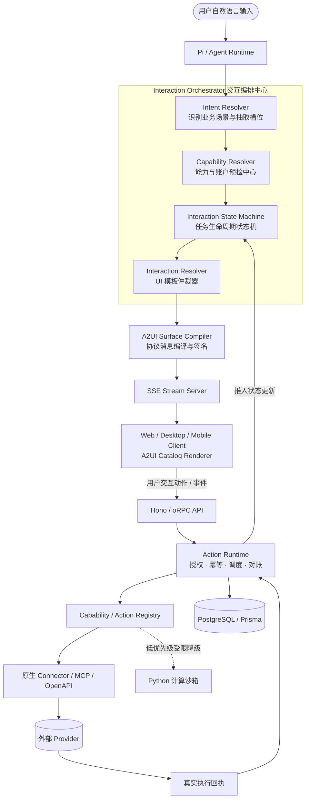
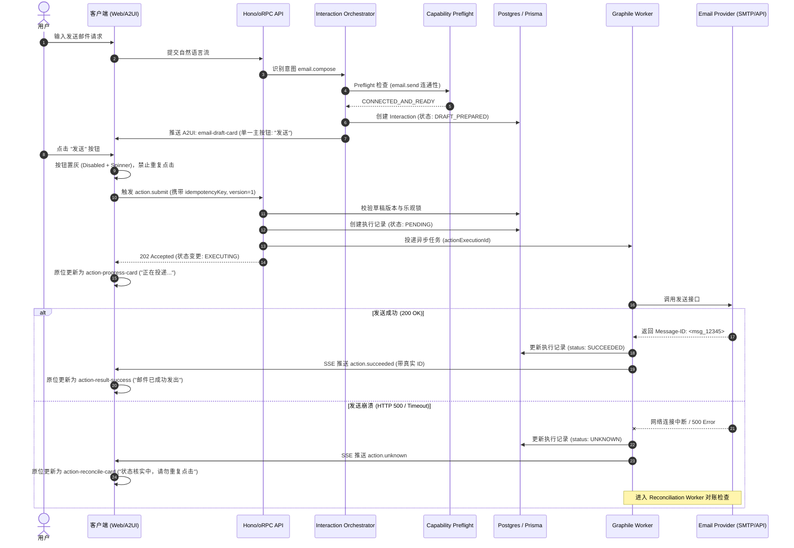

# Matebot × A2UI 交互编排与执行状态机工程规范书

**(Interaction Orchestration & State-Driven Generative UI Specification)**

> **文档地位（本仓库）：** 本文是上传规格的**清理后原文**（修了损坏的 Markdown 表与代码围栏；把示例收件人改成 `example.com`）。**§3–§7 中的包路径与 Prisma 模型名是意向**，在对照 [`matebot-a2ui-orchestration-gap-analysis.md`](./matebot-a2ui-orchestration-gap-analysis.md) 之前**不得**当作落地目录。架构锁以 [`matebot-a2ui-integration-design.md`](./matebot-a2ui-integration-design.md) **v1.1** 为准。采纳而不破坏 v1.1 的条目见 [`matebot-a2ui-orchestration-addendum.md`](./matebot-a2ui-orchestration-addendum.md)。
>
> Feature flag **`a2ui` / `FEATURE_A2UI` 默认关闭**。不改 `MATEBOT_*`。本文不引入运行时行为。

| 属性 | 内容 |
| :--- | :--- |
| **文档版本** | 2.0-PROD-SPEC（仓库收录稿；包路径未对齐） |
| **编制日期** | 2026-11-06 |
| **目标仓库** | `Lizer2009/matebot` |
| **集成协议** | Google A2UI `a2ui-project/a2ui`（v0.9 族渲染；见设计 v1.1 §4） |
| **文档状态** | 意向规格；**不是**已对齐仓库的实施计划 |

---

## 1. 现状缺陷根因剖析与工程基准

### 1.1 缺陷快照复盘分析（基于实机运行截图）

规格原文记录的缺陷卡（早于 tip `7ff96890` 的单按钮 Send；现网截图见 gap analysis）：

```text
+-----------------------------------------------------------+
| 到: recipient@example.com                                 |
| Subject: 一封近况 — 记两件小事                             |
| 消息: 你好，上一封没隔多久……                                |
| [ Confirm ]  [ 发送 ]  <--- 【缺陷 1：按钮语义冲突/冗余】    |
| Internal server error  <--- 【缺陷 2：后端执行崩溃】        |
| 已发送                  <--- 【缺陷 3：前端乐观/模型幻觉状态共存】|
+-----------------------------------------------------------+
```

实机截图中暴露出的核心架构漏洞包括：

1. **双重动作语义混乱（Double-Action Conflict）**：卡片同时挂载 `Confirm` 与 `发送`。用户无法获知“Confirm”是表单校验、内容留存、还是发起授权；且两者未建立互斥锁，极易引发连续触发展开两次 Action 请求。

2. **状态非单一事实来源（State Split-Brain）**：界面同时渲染出红色 `Internal server error` 和普通文本 `已发送`。其根因是：前端组件在点击时做了**乐观状态写入（Optimistic UI）**，或者 Agent 在流中自行吐出对话文本“已发送”，而底层的 HTTP/oRPC 或 Worker 执行实际触发了 500 异常。状态来源分散，未以服务端执行为唯一真理。

3. **能力预检（Capability Preflight）缺失**：卡片在未校验用户邮箱 Provider 是否连接、OAuth Refresh Token 是否有效、发件配额是否存在的情况下，直接将动作暴露为可点击状态。

4. **模型代码逃逸（Ad-hoc Script Escape）**：由于缺少显式强类型的 Capability Registry，底层 Agent（Pi Runtime）将“发邮件”退化为“临时生成 Python 脚本并调用 SMTP/系统脚本”，脱离了平台连接器、审计、重试和幂等管理。

5. **A2UI 模板静态意图驱动而非状态驱动**：卡片仅根据意图 `email.compose` 一次性决定渲染内容，未能根据任务生命周期的转移（草稿中 → 预检失败 → 正在发送 → 异常挂起 → 对账确认）实现原地流式更新。

---

## 2. 核心架构约束与不变量（System Invariants）

在 Matebot 架构中实施本规范时，系统必须严格遵守以下四项不可变原则：

1. **能力编排原则（Orchestrate, Don't Reinvent）**：Agent 负责“调度能力”，绝对禁止为已注册的系统能力（如发邮件、查日历、写文件）临时编写 Python、Shell 或 Node 脚本。

2. **状态权威原则（Single Source of Truth for State）**：UI 上的“已发送”、“失败”、“执行中”等关键状态**必须且仅能**由服务端副作用实体的状态流（SSE）驱动。禁止客户端在接收到最终状态前做乐观成功提示，禁止 LLM 自行在对话文本中宣告带有副作用的外部调用已成功。

3. **两阶段执行与单动作原则（Compose-Execute Decoupling & Unified Button）**：编辑卡片不放置语义重叠的“确认”与“提交”；常规模板提供且仅提供单一语义明确的触发动作（如“发送”）。高风险确认逻辑通过模态弹窗或挂起交互（Approval Flow）实现。

4. **状态驱动 UI 原则（State-Driven UI Resolution）**：决定客户端呈现何种 A2UI 模板的公式恒为：

   `A2UI Template = f(Intent, CapabilityState, InteractionState, RiskLevel, Platform)`

---

## 3. 系统架构演进与交互决策拓扑

> **包名与“Orchestrator / Action Runtime”节点是意向拓扑。** 落地映射见 gap analysis：编排挂在现有 `Thread` / `Run` / `Event` / oRPC SSE 下；副作用走 `ExternalEffect`，不平行新建执行系统。



---

## 4. 核心子模块详细设计规范

### 4.1 能力注册中心（Capability Registry）与工具优先级路由

系统废弃“全开放工具由 LLM 盲选”模式，引入带有执行边界的优先级仲裁器。

#### 1. 工具调用优先级矩阵（Strict Tool Fallback Order）

1. **Tier 1 - 原生业务 Action（Native Actions）**：经过 Schema 强类型约束、带独立鉴权与幂等的内置动作（如 `email.compose` / `email.send`）。
2. **Tier 2 - 已受控注册的 Connector / MCP / OpenAPI Tool**：用户明确授权的第三方服务。
3. **Tier 3 - 原生工作流（Workflow Engine）**：预设的 DAG 流程。
4. **Tier 4 - 隔离计算沙箱（Restricted Python/Bash Sandbox）**：**仅限于纯数学计算、本地数据转换（如 CSV 分析、图表绘制），严禁用于网络外连操作与副作用业务调用。**

#### 2. Capability 合约定义（意向路径 `packages/interaction-contracts/src/capability.ts`）

```typescript
export type CapabilityId =
  | "email.compose"
  | "email.send"
  | "calendar.create"
  | "file.analyze"
  | "compute.python_sandbox";

export type ExecutionPrerequisite = {
  requiresAuth: boolean;
  providerType?: "google" | "microsoft" | "smtp" | "system";
  requiredScopes?: string[];
  allowUnauthenticatedDraft: boolean; // 是否允许在未绑账号前起草
};

export type CapabilityDefinition<TInput = unknown, TOutput = unknown> = {
  id: CapabilityId;
  version: string;
  name: string;
  prerequisites: ExecutionPrerequisite;
  inputSchema: unknown;  // Zod Schema
  outputSchema: unknown; // Zod Schema
  riskLevel: "none" | "low" | "medium" | "high";
  isSideEffect: boolean; // 是否产生真实副作用
};
```

---

### 4.2 能力预检与连接状态解析器（Capability Preflight Resolver）

在任务初始化或 Surface 刷新前，系统必须针对所需 Capability 执行 Preflight 检查，杜绝向客户端下发“不可执行的错误指令”。

#### 1. 账户连通性三态定义

针对 Provider 绑定，严禁使用单一的 `isBound: boolean`，必须使用以下三态：

* `NOT_CONNECTED`：系统内未找到该 Provider 的任何授权记录。
* `CONNECTED_BUT_EXPIRED`：存在凭证，但 Refresh Token 失效、Scope 缺失或账号被冻结。
* `CONNECTED_AND_READY`：凭证合法且存活，具备完全执行权限。

#### 2. Preflight 状态机运转

```typescript
export type PreflightResult = {
  capabilityId: CapabilityId;
  status: "READY" | "REQUIRES_CONNECTION" | "REQUIRES_REAUTH" | "INSUFFICIENT_SCOPE";
  connectionId?: string;
  missingScopes?: string[];
  redirectAuthUrl?: string;
};

export interface ICapabilityPreflightService {
  check(userId: string, capabilityId: CapabilityId): Promise<PreflightResult>;
}
```

* **邮件场景落地规则**：
  * `email.compose` 的 `allowUnauthenticatedDraft = true` → 用户即使未绑定邮箱，也能生成并编辑草稿。
  * `email.send` 的 `allowUnauthenticatedDraft = false` → Preflight 拦截，若非 `CONNECTED_AND_READY`，立即阻断 Action 渲染，并将 UI 决策移交至连接卡片。

---

### 4.3 交互状态机（Interaction State Machine）

交互状态机负责驱动整个业务任务在时间线上的推进，所有动作与流必须对齐状态机节点。

#### 1. 完整状态流向图

```text
      [CREATED]
          │
          ▼
   [RESOLVING_CONTEXT]
          │
   ┌──────┴──────────────────────────┐
   │                                 │ (缺必要信息)
   │ (信息充分)                       ▼
   │                      [NEEDS_CLARIFICATION]
   ▼                                 │
[DRAFT_PREPARED] ◄───────────────────┘
   │
   ├─────────────────────────────────┐
   │ (Preflight 发现未授权)           │ (Preflight 校验通过)
   ▼                                 ▼
[NEEDS_CONNECTION / REAUTH]   [READY_FOR_ACTION]
   │                                 │
   │ (用户完成授权)                   │ (用户点击主操作: 如“发送”)
   └───────────────► ┌───────────────┘
                     │
                     ▼
             [VALIDATING_ACTION]
                     │
                     ▼
             [ACTION_SUBMITTED]
                     │
                     ▼
                [EXECUTING]
                     │
         ┌───────────┼───────────┐
         ▼           ▼           ▼
    [SUCCEEDED]   [FAILED]   [UNKNOWN] (进入 Reconciliation 对账)
```

#### 2. 状态合法变迁与控制表

| 当前状态 | 触发事件 | 目标状态 | 约束前置条件 |
| :--- | :--- | :--- | :--- |
| `DRAFT_PREPARED` | `PREFLIGHT_FAIL` | `NEEDS_CONNECTION` | 缺失可用凭据 |
| `DRAFT_PREPARED` | `PREFLIGHT_OK` | `READY_FOR_ACTION` | 凭据有效，展示主操作按钮 |
| `READY_FOR_ACTION` | `ACTION_INVOKED` | `VALIDATING_ACTION` | 防抖拦截（Debounce），乐观锁锁定 |
| `VALIDATING_ACTION` | `VALIDATION_PASSED` | `EXECUTING` | 写入持久化执行记录（状态=PENDING） |
| `EXECUTING` | `PROVIDER_200` | `SUCCEEDED` | 获取到真实 Provider Message ID / Reference |
| `EXECUTING` | `PROVIDER_4XX_5XX` | `FAILED` | 捕获明确错误，提供重试选项 |
| `EXECUTING` | `TIMEOUT_NO_RESP` | `UNKNOWN` | **严禁回滚或重试，挂起等待后台 Reconciliation** |

---

### 4.4 交互决策器与模板引擎（Interaction Resolver & Template Registry）

拒绝让 LLM 或 Renderer 直接决定组件，由 `InteractionResolver` 进行纯函数式模板计算。

#### 1. 模板分发上下文

```typescript
export type TemplateResolutionContext = {
  intent: string;
  interactionStatus: InteractionStatus;
  preflightStatus: PreflightResult["status"];
  riskLevel: "none" | "low" | "medium" | "high";
  platform: "web" | "electron" | "mobile";
  hasFieldErrors: boolean;
};
```

#### 2. 决策映射表 (The Template Matrix)

| 意图 (Intent) | 交互生命周期状态 | 预检/连通状态 | 命中 A2UI 模板 ID | 主操作按钮（仅一个） | 次操作按钮 |
| :--- | :--- | :--- | :--- | :--- | :--- |
| `email.compose` | `DRAFT_PREPARED` | `REQUIRES_CONNECTION` | `email-connection-card` | **“连接邮箱”** | “放弃” |
| `email.compose` | `DRAFT_PREPARED` | `REQUIRES_REAUTH` | `email-reauth-card` | **“重新授权”** | “放弃” |
| `email.compose` | `READY_FOR_ACTION` | `READY` | `email-draft-card` | **“发送”** | “放弃” |
| `email.send` | `VALIDATING_ACTION` | `READY` | `action-submitting-card` | *禁用（加载状态）* | 无 |
| `email.send` | `EXECUTING` | `READY` | `action-progress-card` | *禁用（Spinner+进度文案）* | 无 |
| `email.send` | `SUCCEEDED` | - | `action-result-success` | **“查看邮件”** | “关闭” |
| `email.send` | `FAILED` | - | `action-result-failed` | **“重试”** | “放弃并关闭” |
| `email.send` | `UNKNOWN` | - | `action-reconcile-card` | **“检查发送结果”** | “稍后处理” |

---

### 4.5 消除状态分裂的动作执行闭环（Action Runtime & Consistency Guard）

针对截图出现的 `Internal server error` 与 `已发送` 矛盾共存问题，本规范定义了强制性的状态推进流程。

#### 1. 状态生命周期实体定义（原文 Prisma `ActionExecution`；落地见 gap analysis → 扩展 `ExternalEffect`）

```prisma
enum ExecutionStatus {
  PENDING
  VALIDATING
  AUTHORIZED
  EXECUTING
  SUCCEEDED
  FAILED
  UNKNOWN
}

model ActionExecution {
  id                String           @id @default(cuid())
  interactionId     String
  idempotencyKey    String           @unique
  actionId          String
  inputHash         String
  status            ExecutionStatus  @default(PENDING)
  providerMessageId String?
  errorMessage      String?
  errorDetails      Json?
  confirmedVersion  Int
  createdAt         DateTime         @default(now())
  updatedAt         DateTime         @updatedAt
  interaction       Interaction      @relation(fields: [interactionId], references: [id])
}
```

#### 2. 客户端、服务端与模型的消息同步契约

* **禁止前端 Optimistic UI 篡改业务文字**：当用户点击“发送”时，客户端按钮变为加载状态（`loading: true, disabled: true`），严禁在接收到服务端推入的成功事件前渲染“已发送”字样。
* **隔离 LLM 消息流与 Action 回执流**：
  * LLM 对话流属于 `chat.text_chunk` 通道；
  * Action 执行状态属于 `a2ui.surface_patch` 或 `interaction.status` 通道。
  * **阻断规则**：若执行记录处于 `EXECUTING` 状态，服务端禁止唤起 Agent 预测“执行结果对话”。Agent 只能在收到成功状态后，被注入包含真实 `providerMessageId` 的系统上下文，再输出后续的总结性对话。
* **服务端 500 异常截断**：若底层 Provider 抛出异常或内部发生 500 错误，API 必须拦截原生 Error Stack，将其转换为受控的失败业务事件推入 SSE，同时原子性将执行记录置为 `FAILED`，强制 Surface 原位刷新为失败模板，严禁向客户端抛出未捕获的 HTTP 500，杜绝外层全局 Error Boundary 导致 UI 局部状态被撕裂。

---

## 5. UI 与组件行为规范（彻底消除按钮歧义）

### 5.1 废弃“Confirm”与“发送”并存设计

1. **常规模板（Medium/Low Risk）**：采用“**所见即所审（WYSIWYG as Review）**”策略。
   * 卡片直接展示只读或内联可编辑的收件人、主题、正文字段。
   * 底部仅设一个主操作按钮（`action: "execute"`），命名为 **“发送”**。
   * 点击即视为对当前卡片内容的审阅完成与执行发起。
2. **高敏感动作（High Risk / Destructive Actions）**：
   * 例如清空邮箱、群发超过 50 人、退订、转账付款等。
   * 交互采用二级确认模态（Step-up Confirmation Dialog），由状态机挂起为 `AWAITING_APPROVAL`，主卡片变为不可交互，弹出全局确认框。
   * **严禁在同一张内联卡片上平铺排列 `[Confirm] [发送]` 两个同级按钮。**

### 5.2 版本失效保护（Draft Mutation Invalidation）

若用户在草稿进入“待发送”就绪态后，再次修改正文或收件人：

* 触发 `field.changed` 事件；
* 服务端更新版本号 `draftVersion++`；
* 先前若存在任何确认授权令牌，立即标记为 `INVALIDATED`；
* 卡片主按钮若处于倒计时或高亮，强制重置为常规“发送”。

---

## 6. 端到端典型场景时序工程规范

### 场景：用户输入“帮我给 recipient@example.com 发一封邮件”且遇到网络故障



---

## 7. 实施路线图与可独立评审的 PR 拆解

> **本节文件范围是意向路径，多数在本仓库不存在。** 按真实包重写后的顺序是 **PR-A′…PR-E′**，见 gap analysis §6。未对齐前不要按下列路径开 PR。

实施必须按顺序推进，前置 PR 验收未通过前，严禁开发后续 PR。

```text
[PR-A: 能力与路由治理]
       │
       ▼
[PR-B: 预检与三态接入]
       │
       ▼
[PR-C: 编排器与模板解耦]
       │
       ▼
[PR-D: 执行强一致与对账]
       │
       ▼
[PR-E: A2UI 渲染器重构]
```

### PR-A：工具能力治理与代码逃逸收拢 (Tooling Governance & Sandbox Boundary)

* **目标**：彻底消除 Agent 临时写 Python 调发邮件的逃逸行为。
* **意向文件范围**：`packages/agent-runtime/src/pi/tools/registry.ts`；`packages/agent-runtime/src/pi/policies/tool-routing.ts`
* **任务清单**：
  1. 建立 Tier 1 原生 Capability 白名单（包含 `email.compose` 与 `email.send`）。
  2. 修改 Pi 提示词与 Tool Provider，使系统意图解析优先走 Action 契约。
  3. 给 Python 解释器工具增加静态分析规则：若输入包含网络请求、系统邮件相关库（如 `smtplib` / `requests` / `socket`），强制拦截报错。
* **验收标准**：输入“帮我发邮件”，Agent 100% 触发内部 Action 逻辑，调用链中 0 次出现 Python 脚本生成。

### PR-B：能力预检与账户状态机 (Capability Preflight & Provider State)

* **目标**：在 Action 呈现前确定连接状态，支持未绑定/过期授权的优雅流转。
* **意向文件范围**：`packages/interaction-runtime/src/capability/preflight.ts`；`packages/interaction-contracts/src/preflight.ts`
* **任务清单**：
  1. 实现 `CapabilityPreflightService`。
  2. 实现邮箱 Provider 的三态检测逻辑（`NOT_CONNECTED` / `EXPIRED` / `READY`）。
  3. 将 Preflight 输出接入 Interaction 创建管道。
* **验收标准**：未绑定邮箱时，系统给出连接引导卡片，绝对不展示可点击的“发送”按钮。

### PR-C：交互编排器与模板仲裁器 (Interaction Orchestrator & Template Registry)

* **目标**：由状态驱动模板选择，彻底废除组件名硬编码。
* **意向文件范围**：`packages/interaction-runtime/src/orchestrator/`；`packages/interaction-catalog/src/templates/`
* **任务清单**：
  1. 建立 `TemplateRegistry`，实现 `InteractionResolver`。
  2. 配置邮件相关的模板映射元数据（对应本文 4.4 节）。
  3. 编译生成的 A2UI JSON 进行 Schema 校验与 Catalog 白名单过滤。
* **验收标准**：单元测试断言所有状态组装条件下的模板输出；无未匹配状态的 Fallback 错误。

### PR-D：执行原子性、幂等与对账闭环 (Action Consistency & State Reconciliation)

* **目标**：彻底解决 `Internal server error` 和 `已发送` 矛盾共存现象。
* **意向文件范围**：`packages/action-runtime/src/executor/`；`packages/action-runtime/src/reconciliation/`；`apps/api/src/routers/action.ts`；`packages/persistence/prisma/schema.prisma`
* **任务清单**：
  1. 引入 `ActionExecution` 实体及悲观/乐观锁。
  2. 后端执行包裹 `try-catch-reconcile` 结构，屏蔽未处理的裸 HTTP 500。
  3. 建立对网络超时状态进入 `UNKNOWN` 的机制，通过 Graphile Worker 实现定时对账。
* **验收标准**：模拟外部 Provider 抛错，客户端只收到受控错误卡片，严禁出现乐观的“已发送”提示。

### PR-E：前端按钮重构与 A2UI 卡片状态同步 (Frontend Action Guard & Unified Button)

* **目标**：移除前端重复按钮，绑定 SSE 单一数据源。
* **意向文件范围**：`packages/a2ui-web/src/components/email/EmailDraftCard.tsx`；`packages/a2ui-web/src/renderer/SurfaceRenderer.tsx`
* **任务清单**：
  1. 重写 `email-draft-card`，仅保留一个操作主按钮。
  2. 移除客户端本地 state 中的 `isSent` 乐观标记，卡片展示状态完全通过 props 中的执行状态计算。
  3. 增加网络断开重连逻辑，断线恢复自动拉取最新的 Surface Snapshot。
* **验收标准**：实机运行截图中出现的两个按钮、双重错误状态彻底绝迹。

---

## 8. 生产验收标准（Definition of Done）

任何宣称本规格落地完成的 PR，必须通过以下验收用例套件。用例在 tip 上的有效性见 gap analysis §7。

| 编号 | 测试场景 | 操作步骤 | 预期判定 |
| :--- | :--- | :--- | :--- |
| **TC-01** | 干净环境起草 | 注册新账号（未绑邮箱），请求“给 test@example.com 发一封邮件” | 生成草稿卡片，底部主按钮显示为 **“连接邮箱”**，无“发送”按钮，无 Python 脚本调用 |
| **TC-02** | 正常链路发送 | 绑定邮箱后，请求起草并点击 **“发送”** | 按钮单一；点击后立即置灰；SSE 返回真实 Provider 成功事件；界面原地变为“发送成功”卡片，带 Provider 邮件引用编号 |
| **TC-03** | 幂等防重保障 | 点击“发送”瞬间，使用脚本模拟并发发送 10 次相同请求 | 系统仅受理 1 次，其余触发幂等冲突拦截，邮件仅向 Provider 投递一次 |
| **TC-04** | 异常隔离阻断 | 注入故障使 Provider 接口返回 500 异常 | 界面显示受控失败态，提供“重试”；**绝无“已发送”字样，控制台无未捕获的 Unhandled Server Error** |
| **TC-05** | 草稿变更失效 | 点击发送前，用户在卡片正文追加一个字 | 原有确认令牌失效，`draftVersion` 自增；重新渲染待发送状态 |
| **TC-06** | 超时挂起对账 | 断开 Worker 外网使 Provider 调用超时 | 状态机进入 `UNKNOWN`，展示“正在确认结果”；外网恢复后由对账机制置为最终态，无模型胡乱生成的总结文本扰乱会话 |
