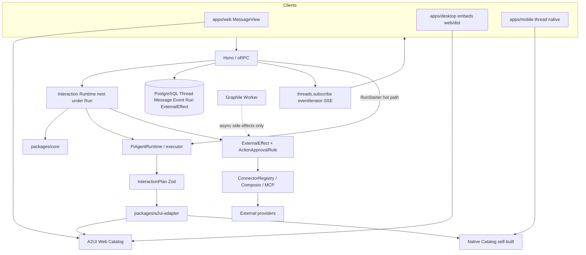
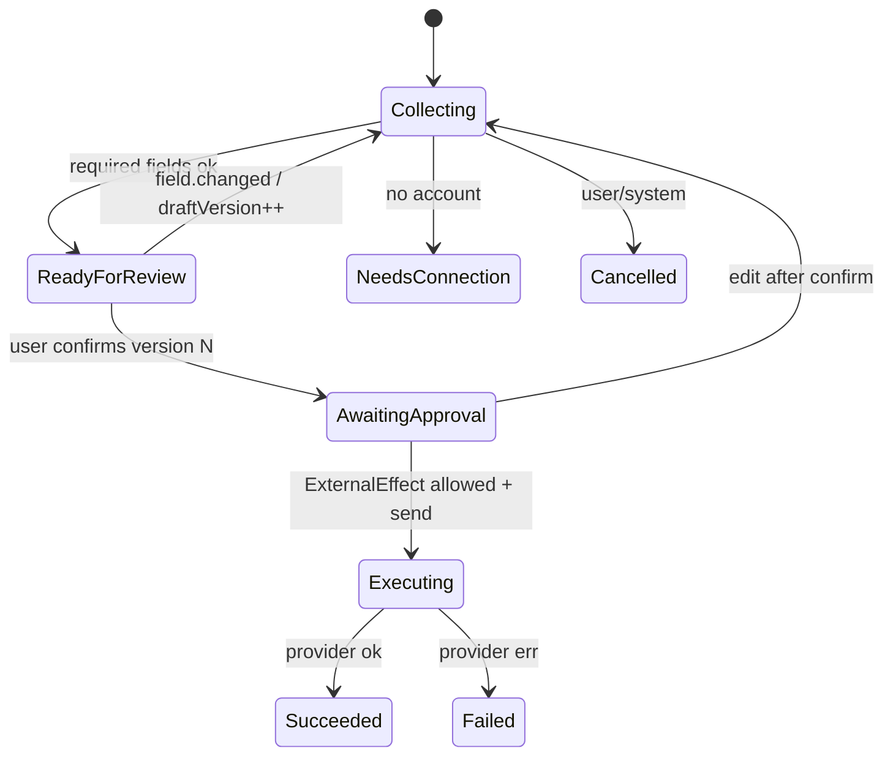

# Matebot × A2UI 集成设计（v1.1）

**文档版本：** 1.1（审计对齐修订）  
**编制日期：** 2026-11-06  
**基线：** Phase 0 源码审计 [`matebot-a2ui-source-audit.md`](./matebot-a2ui-source-audit.md) + 缺口清单 [`matebot-a2ui-gap-checklist.md`](./matebot-a2ui-gap-checklist.md)  
**对照原文：** Matebot × Google A2UI 集成方案 v1.0（上传稿；与审计冲突处以审计为准）  
**性质：** 修订后的集成设计 / 规格说明——**不是**可逐 PR 编码的实现计划细稿；实现者可据此直接开 PR-1（contracts），无需再猜 Conversation / SSE / Approval 落点。  
**范围：** 文档 only；本文件不引入运行时行为。

---

## 0. 执行摘要

### 0.1 核心结论

A2UI 是 Matebot 实现**对话内、声明式、可流式更新**交互界面的协议层。仅接入渲染器不足以获得「丝滑」体验；需要四层协同：

1. **A2UI Protocol & Catalog Renderer** — 把受控 Surface 渲染到 Web / Electron / Mobile。
2. **Interaction Runtime** — 意图、槽位、Surface 版本、恢复；**挂在现有 `Thread` / `Event` / `Run` 之下**，不是第二套会话或 Run 系统。
3. **Action 路径** — **扩展**现有 `ExternalEffect` + `ActionApprovalRule` + `ask` + `threads.answer`；Compose 与 Send 分离；草稿 `draftVersion` / `confirmedVersion` 规则。
4. **Context Resolver** — 对话、偏好、已连接账户、联系人、任务附件；推断不得冒充授权。

原则（保留自 v1.0）：

> **LLM 决定「用户想做什么」和「还缺什么」；Matebot 后端决定「允许做什么、当前状态是什么」；A2UI 负责「如何呈现」；现有 Action / ExternalEffect 路径负责「如何安全执行」。**

模型输出受约束的 `InteractionPlan`；服务端校验并编译为 A2UI 消息；客户端只用本地批准的 Catalog 渲染。禁止模型直接生成任意 HTML / React / JSX / JS / Shell 作为 UI。

### 0.2 与 v1.0 的关键校正（必须）

| 主题 | v1.0 假设 | v1.1（审计锁定） |
| --- | --- | --- |
| 会话 | Conversation | **`Thread`**；Interaction FK = `threadId` |
| 时间线 | 旁路或专用卡片通道 | **`MessageBlock.kind` + `ProductEvent`**；A2UI 为新 kind / 受控扩展 |
| 实时 | 泛化 SSE；易被读成新总线 | 现有 **oRPC `eventIterator` → SSE** + `threads.subscribe({ cursor })`；**禁止**新 WebSocket 聊天总线 |
| 审批 / 幂等 | 新建 Approval / ActionExecution | **扩展** `ExternalEffect` + rules + ask；邮件加 draft/confirmed 版本规则 |
| Run | 易暗示平行执行系统 | 现有 **Task → Run → Attempt**；Interaction Runtime **嵌套**其下 |
| Worker | 易暗示 interactive 入队 | **异步副作用 only**；交互 turn 留在 API 热路径 `RunStarter` |
| Generative UI | 未定义 page-kit | **Page = artifact（`kind: page`）**；**A2UI = 对话内交互 Surface**；永不合并/替换 |
| Packages | §14 六七个新包 | **Extend-first**；最多薄 **`packages/a2ui-adapter`** |
| 部署 | — | **`MATEBOT_*` / DB roles / compose volumes 不变** |
| Mobile | 可评估社区 RN | **自建 Native Catalog**；无官方 RN renderer；`saved-chats` ≠ 跨设备真相 |
| 协议 pin | 锁死 v0.9.1 | 见 §4：**渲染 pin v0.9 族**；**服务端双轨**；依赖 pin 到具体 commit |

### 0.3 产品交付目标（Email-first MVP）

用户说「帮我发一封邮件」时，Matebot 应当：

- 理解意图，不要求学习工具名；
- 从当前线程、联系人、账户、偏好提取可用信息；
- 只询问真正缺失且影响执行的字段；
- 在聊天时间线内生成可编辑邮件 Surface；
- 用户可改收件人 / 主题 / 正文；
- 发送前展示最终版本与发送账户；
- **明确确认后**才执行发送；
- 过程显示真实进度，成功后回传提供商结果；
- 刷新 / 断线 / 换设备后，**服务端**草稿与交互可恢复；
- 不因重试重复发送。

### 0.4 文档关系

```text
matebot-a2ui-source-audit.md                  ← 事实源（路径/符号）
matebot-a2ui-gap-checklist.md                 ← P0/P1 缺口
matebot-a2ui-integration-design.md            ← 本文件（设计 v1.1）
MATEBOT_A2UI_ORCHESTRATION_SPEC.md            ← 编排意向规格（包路径未对齐）
matebot-a2ui-orchestration-gap-analysis.md    ← 编排规格 vs 本设计 / tip 对照
matebot-a2ui-orchestration-addendum.md        ← 采纳编排意图、不破坏 v1.1 的不变量
```

冲突时：**审计 > 本设计 > 编排 addendum / gap analysis > 编排规格原文 > v1.0 原文**。  
编排规格中的新包名与 `ActionExecution` 表是意向，不是对本设计 §10 / §7 的修订。

---

## 1. Goals / Non-goals

### 1.1 Goals

- 在 **不破坏** 现有 Web / Electron / Mobile 架构与 0.6.0 生产行为的前提下，引入声明式 Generative UI。
- 建立 **可恢复** 的对话内交互（Surface + 草稿版本 + 确认）。
- 把副作用执行收敛到 **现有审批与幂等骨架**。
- 首个业务闭环：**Email Compose → Review → Confirm → Send → Provider Result**（经现有 Composio / connectors + `ExternalEffect`）。
- Feature flag 默认关闭，生产保持 0.6.0 行为；长生命周期集成分支与 main 可并行。

### 1.2 Non-goals（v1.1 / Phase 1–3）

- 不重写 Pi / Agent Runtime。
- 不引入并行 AG-UI / A2A / WebSocket 聊天协议。
- 不把 A2UI 并进 `@matebot/page-kit`，也不用 page-kit 充当 A2UI。
- 不新建完整 Approval / ActionExecution / Conversation / 第二套 Run 表，除非后续 PR 证明现有模型不可扩展。
- 不一次性新建六七个 interaction/a2ui 包。
- 不依赖未发布的 `@a2ui/agent`。
- 不把 mobile `saved-chats` 当作跨设备 Interaction 权威。
- 不改 `MATEBOT_*` 环境变量名、DB 角色名、compose volume 命名。
- 不把「支持全部动态组件」当作第一版目标。

---

## 2. 产品体验原则（保留自 v1.0）

「丝滑」= 更低的认知负担、等待、重复输入与失败恢复成本——不是更炫的动画。

| 原则 | 含义 |
| --- | --- |
| **Intent-first** | 用户表达目标；内部映射 `email.compose` 等意图，而非逼用户选 Tool。 |
| **Context-first** | 解析顺序：显式用户输入 → 当前线程消息 → 当前 Interaction 已收集数据 → 附件/实体 → 已授权账户/联系人 → 用户偏好 → 最后才追问。记录来源与置信度；猜测 ≠ 授权。 |
| **Progressive disclosure** | 先可执行草稿；只对缺失必需字段展示控件。 |
| **Inline interaction** | Surface 是时间线一等公民，不跳独立设置页；可继续聊天并更新原 Surface。 |
| **Streaming** | 先反馈意图与骨架，再流式补字段/校验/进度；勿等整段 LLM 结束再出表单。 |
| **Recoverable** | 服务端权威恢复 Surface、字段、确认态、执行中 Action 与结果。 |
| **Safe by default** | 发送邮件等副作用必须经明确授权；UI「预览」≠「确认执行」。 |

---

## 3. 架构与职责边界

### 3.1 逻辑架构（对齐 Matebot 现状）



### 3.2 职责边界

| 层 | 职责 | 不应承担 |
| --- | --- | --- |
| Chat Client | 时间线、输入、Catalog 渲染、提交用户意图 | 决定是否有权执行副作用 |
| `a2ui-adapter` | 协议校验、版本路径、Plan→A2UI 编译 | 业务意图判断 |
| Catalog Renderer | 白名单组件 → 平台 UI | 执行任意代码 / 直连 Provider |
| Interaction Runtime | 槽位、Surface 版本、生命周期（API + `core`） | 直接打第三方 API |
| Context Resolver | 收集上下文并标注来源 | 把推断当授权 |
| Agent / Pi | 语言理解、规划、生成 `InteractionPlan` | 绕过审批执行副作用 |
| Action 路径 | 审批、幂等、`ExternalEffect`、connector 执行 | 擅自改 UI 结构 |
| Persistence | Thread/Message/Event/Run/Effect 为真相 | 以客户端或 saved-chats 为真相 |
| Graphile Worker | 异步 send 对账、恢复类 job | interactive turn 热路径 |

### 3.3 关键设计原则

- **A2UI 是呈现协议，不是业务工作流引擎。**
- **服务端 Interaction / Event 是业务交互权威；客户端只显示与提交意图。**
- **副作用唯一受控入口 = 现有 Action 审批 + `ExternalEffect`（可扩展字段），不是平行 Action Runtime 产品名下的新系统。**
- **Interaction Runtime 嵌在 `Run` / `Event` 生命周期内**，不另起 Run。

### 3.4 真实调用链中的插入点

审计 §16 基线不变；A2UI 插入点：

```text
threads.send → Message/Event/Task/Run → RunStarter → executor → Pi
  →（规划）InteractionPlan
  → API 校验 → a2ui-adapter 编译
  → 写 Event / MessageBlock（surface kind）→ SSE
Client Catalog 渲染
  → oRPC（扩展 answer 或 interaction.*）字段变更 / 确认
  → ExternalEffect + 必要时 Worker 对账
```

---

## 4. 协议版本与依赖 pin（v1.1 锁定）

### 4.1 上游事实（审计 §12）

| 项 | 事实 |
| --- | --- |
| `specification/versions.json` | **v1.0 = `current`**；v0.9.1 / v0.9 = `previous`；v0.8 = deprecated |
| `@a2ui/web_core` | 导出 `./v0_8`, `./v0_9`, **`./v1_0`** |
| `@a2ui/react` 0.15.x | 导出 `.`, `./v0_8`, `./v0_9`, `./styles`——**无清晰 `./v1_0`** |
| React Native | 官方树无 RN renderer |
| `@a2ui/agent` | 未发布；**不依赖** |

### 4.2 决策（业务不要锁死字面「仅 v0.9.1」或 Day-1 生产 v1.0）

1. **Phase 1 渲染 pin = v0.9 族**：以 `@a2ui/react` 兼容性检查后**实际绑定**的协议 minor 为准（通常为 v0.9 / v0.9.1 语义族）。
2. **服务端 adapter 双轨**：现在用 `web_core` 的 `./v0_9` 校验/编译；**预留** `./v1_0` schema 路径与内部版本枚举，业务代码只依赖 Matebot `InteractionPlan` + adapter 接口，不散落协议字面量。
3. **不要**因 versions.json 的 `current` 就在 Day-1 把生产业务锁在 v1.0——以 **React renderer 支持面** 为准。
4. **不要**把产品文案/契约写成「仅支持 v0.9.1」以致无法升级；对外文档写「v0.9 family + dual-track server」。

### 4.3 依赖 pin 与 pnpm 安装策略

Matebot 使用 **pnpm workspace**；上游 a2ui 示例常用 yarn——**禁止**把 a2ui 仓库 merge 进 Matebot yarn workspace。

推荐顺序（PR-2 选定一种并钉死）：

| 策略 | 做法 | 适用 |
| --- | --- | --- |
| **A. Git commit subpath**（首选早期） | `pnpm` 依赖 `github:Lizer2009/a2ui#<commit>` + package subpath（`@a2ui/web_core` / `@a2ui/react`）；在设计与 lockfile 写明 **完整 commit SHA** | 上游未稳定发 npm 或需精确复现 |
| **B. 已发布 npm** | 当官方/可信 npm 版本可用且与 pin 策略一致时，改为 registry 版本并记录精确版本 | 生产稳定后 |
| **C. Vendor 拷贝** | 仅当 A/B 因构建或许可证不可用时，把所需 schema/包 vendoring 进薄 `a2ui-adapter`；保持可追溯上游 commit | 兜底 |

约束：

- Pin **具体 commit**（或具体 npm 版本），禁止浮动 `main`。
- `a2ui-adapter` 通过动态 `import()` 或明确依赖边界加载 `@a2ui/*`（可选能力；未配置时产品无 A2UI）。
- 离线 CI：schema 级 conformance 测试不依赖外网；若需 fixture，检入最小 JSON 样本。

### 4.4 日后 re-pin 流程

1. 在隔离分支上升级 pin commit / npm。
2. 跑 adapter 双轨 schema 测试 + Web Catalog fixture。
3. 若 `@a2ui/react` 出现可用的 v1.0 导出：先把 **编译默认输出** 切到 v1.0，保留 v0.9 读取兼容一个发布窗口，再关旧路径。
4. Mobile Native Catalog 同步协议语义（组件能力矩阵），再开 feature flag。
5. 更新本设计「当前 pin」表（实现 PR 的 `## Changes` 引用 commit）。

**当前 pin（PR-2）：** `Lizer2009/a2ui@dee8167996b0a802b18b3ebe51f3515c55b757de` · npm `@a2ui/web_core@0.15.0`（§4.3 **B**；A 的 git+subpath 因上游 `prepare` 需 Yarn 4/Corepack，在 Matebot CI 失败）· render family: **v0.9** · server: **v0.9 + reserve v1.0**。详见 `packages/a2ui-adapter/README.md`。

---

## 5. page-kit 与 A2UI 共存

| 维度 | `@matebot/page-kit` | A2UI Surface |
| --- | --- | --- |
| 消息形态 | `MessageBlock.kind: "page"` | **新** `MessageBlock.kind`（如 `a2ui_surface`）或受控扩展 |
| 本质 | **Artifact**：可保存/分享的文档或仪表板 | **对话内交互事务**：可编辑草稿 + 确认 |
| 作者 | 模型写受限 JSX → 校验/编译 | 服务端从 `InteractionPlan` **编译**协议消息 |
| 执行 | 浏览器沙箱跑编译后的 JS | Catalog **声明式**渲染；无任意脚本 |
| 状态权威 | `Page` / `PageVersion` | Interaction + `Event` / Message（服务端） |
| 安全故事 | 「校验非安全边界，沙箱才是」 | Catalog 白名单 + schema |

**禁止：** 用 page-kit 充当 A2UI；或把 A2UI 编译进 Page JSX；或让二者互相替换。  
**允许：** 同一 `Thread` 同时出现 page 卡片与 A2UI Surface（例如总结页 + 发信草稿）。

---

## 6. 映射表：设计概念 → Matebot 路径 → Reuse | Extend | New

| 设计概念 | Matebot 路径 | 动作 |
| --- | --- | --- |
| Conversation | `Thread` | **Reuse**（命名对齐；FK `threadId`） |
| Message 时间线 | `Message` + `MessageBlock` + `projectMessages` | **Extend**（新 kind） |
| 实时事件 | `Event` / `ProductEvent` / `threads.subscribe` | **Reuse** transport；**Extend** 事件类型 |
| Agent 执行 | `Task` → `Run` → `Attempt` + `RunStarter` | **Reuse** |
| Interaction Runtime | `apps/api` services + `packages/core` | **Extend** + 最小 **New** 实体（见 §7） |
| Surface 呈现 | Web `message-view` / Mobile `thread-*` | **Extend** |
| A2UI 协议适配 | `packages/a2ui-adapter`（薄） | **New** |
| 审批 / 幂等 | `ExternalEffect`, `ActionApprovalRule`, `ask`, `threads.answer` | **Extend** |
| Action Registry | `action-approval.ts`, connectors, builtin tools | **Extend**（映射，不平行） |
| 异步副作用 | `apps/worker` + `background-jobs.ts` | **Extend**（如 `action.execute`） |
| Page 工件 | `page-kit`, `Page`/`PageVersion`, `kind: page` | **Reuse as sibling** |
| Electron | `apps/desktop` → `web/dist` | **Reuse** |
| Mobile Catalog | `apps/mobile/components/thread` | **New**（自建） |
| Contracts | `packages/contracts` Zod + rpc | **Extend** |
| 部署名 | `MATEBOT_*`, roles, volumes | **禁止改名** |

---

## 7. 数据模型

### 7.1 已有权威模型（优先）

```text
Thread ── Message (seq, blocks Json)
       ── Event   (seq)          ← SSE / 投影权威
       ── Task ── Run ── Attempt
                      └── ExternalEffect (idempotencyKey unique)
```

| 模型 | A2UI 含义 |
| --- | --- |
| `Thread` | 会话容器（原 Conversation） |
| `Message` | 时间线；A2UI 以 `blocks` 成员出现 |
| `Event` | 实时真相；Surface 更新帧可作为 payload 或新 `ProductEventType` |
| `Run` / `Attempt` | Agent 执行单元；Interaction 嵌套其下 |
| `ExternalEffect` | 副作用意图、审批结果、幂等 |

### 7.2 最小新增（PR-4 二选一，设计预留）

审计：Interaction / Surface **尚不存在**。v1.1 允许两种落地，PR-4 用证据二选一：

**选项 A — 最小表（跨设备草稿推荐）**

- `Interaction`：`id`, `threadId`, `runId?`, `intent`, `status`, `draftVersion`, `confirmedVersion?`, `plan` Json, timestamps  
- `InteractionSurface`（可选）：`id`, `interactionId`, `surfaceId`, `protocolVersion`, `document` Json / 增量指针  

**选项 B — 先嵌入 Event/Message**

- Surface 快照与 `draftVersion` 写入 `Event.payload` + `MessageBlock`；确认绑定写入 `ExternalEffect.request`  
- 仅当跨设备恢复与并发编辑证明不够时再升到选项 A  

无论哪项：**客户端 saved-chats 不是权威**。

### 7.3 `MessageBlock` 扩展方向

在 `packages/contracts` 的 `MessageBlock` discriminated union 增加例如：

- `kind: "a2ui_surface"`（名称以 PR-1 Zod 为准）  
  - `interactionId`, `surfaceId`, `protocolFamily`（`v0_9` | `v1_0`）, `draftVersion`, 渲染所需摘要或引用  

业务专用「email-draft-card」**优先**表现为 Catalog 组件 + 同一 surface kind，而不是无限增殖 block kind——除非现有 `ask`/`card` 语义无法承载。

### 7.4 草稿版本 × 审批（相对现有 ask 的缺口）

现有 `ask` + `approvalEffectId` 绑定的是 **effect/request**，不是可编辑草稿的 version hash。邮件闭环必须：

| 规则 | 行为 |
| --- | --- |
| 每次用户改字段 | `draftVersion` 递增；清 `confirmedVersion`（或标记 stale） |
| 用户点确认 | 服务端校验当前草稿；写入 `confirmedVersion = draftVersion`；创建/更新 `ExternalEffect` |
| 确认后、发送前再改 | 旧确认失效；必须重新确认 |
| 发送 | 仅当 `confirmedVersion === draftVersion` 且 effect 未成功；`idempotencyKey` 唯一 |
| 重放 | 已成功的 effect 不得再次执行 |



状态转换**仅服务端**有效；客户端不能自行宣称 `SUCCEEDED` / `APPROVED`。

---

## 8. API / SSE 与 ProductEvent

### 8.1 传输（锁定）

- **订阅：** `threads.subscribe` → oRPC `eventIterator(ProductEventSchema)` → `text/event-stream`  
- **恢复：** 显式 **`cursor` / `seq`** + `threads.get` snapshot；**不要**假设浏览器 `Last-Event-ID` 语义（若提及，映射到 cursor）  
- **扇出：** `RealtimeFanout` 仅跨进程 latch，不替代 Event 持久化  
- **禁止：** 为 A2UI 新建 WebSocket 聊天总线（Computer screen proxy 的 WS 与聊天无关）

### 8.2 用户动作回传

复用模式：`threads.send` / `threads.answer` / `threads.followUp` / `threads.stop`。

A2UI 字段变更与确认：

- **优先**扩展 `threads.answer`（或同风格的 `threads.*` / `interaction.*` oRPC），服务端校验版本后写 `Event`，再 SSE 推送；  
- 不要让客户端直写 Surface 最终态。

### 8.3 事件形状（对齐 ProductEvent；PR-1 定 Zod）

概念事件（实现时并入 `ProductEventType` 或 payload 扩展，保持 discriminated union）：

| 概念 type | 含义 | 映射建议 |
| --- | --- | --- |
| `interaction.created` / `updated` | 交互生命周期 | 新 ProductEvent 或 thread 级 payload |
| `surface.created` / `updated` | A2UI 帧 / 文档补丁 | 驱动 MessageBlock 投影 |
| `field.changed` | 用户改槽位（也可仅作服务端内部） | 写 Event 后广播 surface.updated |
| `approval.requested` | 需确认 | 可与现有 `ask` 块并存或组合 |
| `action.started` / `progress` / `succeeded` / `failed` | 副作用进度 | 对齐 `thread.progress` / tool 事件 + ExternalEffect 状态 |

流式原则：先 `surface` 骨架，再增量更新；最终结果落到稳定 `Message` 投影。

### 8.4 InteractionPlan（contracts，非协议原文）

模型 → Zod `InteractionPlan`（示意，PR-1 落地）：

```ts
type InteractionPlan = {
  intent: string;
  title: string;
  summary?: string;
  fields: Array<{
    name: string;
    value?: unknown;
    required: boolean;
    status: "resolved" | "missing" | "needs_confirmation" | "invalid";
    source?: string;
    confidence?: number;
  }>;
  nextStep:
    | "render"
    | "ask"
    | "request_connection"
    | "request_approval"
    | "execute"
    | "complete";
  riskLevel: "low" | "medium" | "high";
};
```

流水线：`LLM → InteractionPlan → Server Validator → Catalog Template / Surface Compiler → A2UI`。

---

## 9. Action、安全、幂等与 Email

### 9.1 扩展现有路径，不平行发明

| 能力 | 落点 |
| --- | --- |
| 是否询问 | `ActionApprovalRule` / 用户规则 / Settings → Approvals |
| 聊天内确认 UX | `MessageBlock` `kind: "ask"` + `AskCard` + `threads.answer` |
| 副作用记录 | `ExternalEffect`（`kind`, `idempotencyKey`, `request`/`result`, `reviewDecision`） |
| 工具执行 | `ConnectorProvider` / builtin tools；UI **禁止**直连 Provider |
| 暂停 run | `waiting_input` + 审批续跑（现有 executor） |

仅当「草稿版本绑定确认」无法用 `ExternalEffect.request` + Interaction 字段表达时，才考虑新表字段——**不是**新 Approval 产品表。

### 9.2 Compose vs Send（Email）

- `email.compose` / validate：无外部副作用；可更新 Surface。  
- `email.send`：创建 `ExternalEffect`；过审批；`idempotencyKey`；异步时可登记 Worker job（如 `action.execute` / reconcile），**字段编辑不进 Worker**。  
- 连接器：现有 Composio 等 `Connection`；发送账户必须仍有效且用户有权。

### 9.3 发送前服务端检查清单

1. 用户拥有该 `threadId` / Interaction  
2. Connector 仍有效  
3. `confirmedVersion === draftVersion`  
4. 字段通过服务端 Schema  
5. 所需 scope / 审批策略已满足  
6. 该 effect 尚未成功  
7. 幂等键未被其他成功执行占用  

### 9.4 其他安全控制

- Catalog 白名单；拒绝未知组件名。  
- 不把 `surfaceId` 当权限凭证。  
- 不把客户端 `confirmed: true` 当服务端授权。  
- Electron：外链与文件权限纳入 Desktop 回归（审计 P2）。  
- 供应商名仅出现在 adapters；contracts/UI 保持中立（`AGENTS.md`）。

---

## 10. 包与代码落位（Extend-first）

| 模块 | 落位 |
| --- | --- |
| InteractionPlan / ProductEvent / RPC | `packages/contracts` |
| 状态机 / 策略纯函数 | `packages/core` |
| Prisma / Event 写入 | `packages/db` |
| Pi / connector / approval-ask | `packages/adapters` + `adapter-kit` |
| A2UI 校验/版本/编译 | **`packages/a2ui-adapter`**（薄；或先 `adapters` 子目录再拆） |
| Web Catalog 宿主 | `apps/web`（`message-view` / cards）；tokens 走 `@matebot/ui-tokens` |
| Native Catalog | `apps/mobile`（未来若膨胀再考虑 `a2ui-native`） |
| 编排 | `apps/api`；异步 `apps/worker` |
| page-kit | **保持独立 sibling** |

**拒绝 v1.0 §14** 一次性新建：`interaction-contracts` / `interaction-runtime` / `action-runtime` / `interaction-catalog` / `a2ui-web` / `a2ui-native` 等一串包。

---

## 11. 多端策略

| 端 | 策略 |
| --- | --- |
| Web | `@a2ui/react`（pin 后）封装为 Surface 宿主；主题映射 ui-tokens |
| Electron | 复用 `web/dist`；不维护第二套协议 |
| Mobile | **自建** Native Catalog（TextField / Sheet / Picker / Switch / Button 等）；协议语义对齐 pin 版本；社区 RN renderer **不作**生产默认 |
| 恢复 | 服务端 Event/Snapshot；mobile `saved-chats` 仅本地缓存 |

---

## 12. 分阶段路线图与分支策略

### 12.1 分支策略

- 长生命周期集成线：自 **main 0.6.0 线** 拉出 **`feature/a2ui`**（或等价命名），承载后续实现 PR 的合并目标。  
- **本设计文档 PR 不合并进 main 的运行时**；文档可先合入 `feature/a2ui` 或按维护者意愿合文档-only 到 main——**运行时代码**仅在完整测试 + feature flag 关闭默认后合并。  
- Feature flag：未开启时生产行为 = **0.6.0**（无 A2UI Surface、无新 RPC 副作用）。  
- 约束回顾：不碰 `MATEBOT_*` / roles / volumes；不并 page-kit；不新 WebSocket 聊天总线；不改 interactive 热路径入全局队列。

### 12.2 PR 链

| PR | 内容 | 说明 |
| --- | --- | --- |
| **PR-0** | Phase 0 审计 + 缺口清单 | **已完成**（本仓库文档） |
| **PR-0.1** | 本设计 v1.1 | **本文档**（docs-only） |
| **PR-1** | contracts：`InteractionPlan`、surface 相关 ProductEvent / MessageBlock、RPC 草约 | **无 renderer** |
| **PR-2** | `a2ui-adapter`：pin commit、双轨 schema 测试 | 无产品 UI |
| **PR-3** | Web Surface 宿主 + fixture | `MessageView` 扩展 |
| **PR-4** | 最小 Interaction/Surface 持久化或 Event 嵌入证明 | 迁移须兼容旧 API |
| **PR-5** | Interaction Runtime（意图/槽位/版本） | 挂 Run/Event |
| **PR-6** | ExternalEffect 扩展 + draft/confirmed 规则 | 不新 Approval 表 |
| **PR-7–8** | Email UI + Send / Worker 对账 | Composio/connectors |
| **PR-9** | Snapshot / 跨设备恢复加固 | cursor + 服务端权威 |
| **PR-10** | Mobile Native Catalog | 自建 |

### 12.3 MVP 完成定义（相对 v1.0 §18）

- 受控 A2UI Surface 出现在线程时间线；  
- Interaction 可恢复（服务端）；  
- Email compose/edit/confirm/send 闭环；  
- 幂等发送；  
- Web（含 Electron）可用；Mobile 可随后或并行但语义一致；  
- Flag 关闭时无行为回归。

---

## 13. 测试策略（设计级）

- **单元：** InteractionPlan Zod、版本编译、draft/confirm 规则、幂等键。  
- **集成：** Event 投影 → MessageBlock；`threads.subscribe` 推送；answer 续跑。  
- **E2E：** Email 路径（确定性 fixture / 假 connector）；勿依赖真实第三方。  
- **安全：** 未知组件拒绝；未确认拒绝 send；版本冲突；越权 thread。  
- **Judge：** 自然语言体验断言若需要，用版本化 rubric（`AGENTS.md`），不用关键字列表。

---

## 14. 风险与取舍

| 风险 | 缓解 |
| --- | --- |
| LLM 输出漂移 | InteractionPlan + 服务端模板编译 |
| 双写审批状态 | 只扩展 ExternalEffect / ask |
| 协议升级 | adapter 双轨 + re-pin 流程 |
| page-kit 混淆 | §5 硬边界 |
| Mobile 无官方 renderer | 自建 Catalog；Web 先行 |
| 过度分包 | Extend-first |
| 热路径入队 | 遵守 `docs/run-execution.md` |

---

## 15. Changelog：v1.0 → v1.1

1. **Conversation → Thread**；全文 FK/`threadId`。  
2. 时间线改为 **MessageBlock + ProductEvent**；禁止旁路消息系统。  
3. 传输锁定为现有 **oRPC SSE + cursor**；删除「新聊天 WebSocket」空间。  
4. Action/审批改为 **扩展 ExternalEffect + ActionApprovalRule + ask + threads.answer**；补充 **draftVersion / confirmedVersion**。  
5. Run 明确为现有 Task/Run/Attempt；Interaction **嵌套**，无第二 Run 系统。  
6. Worker 仅异步副作用；interactive 留 **RunStarter** 热路径。  
7. 新增 **page-kit vs A2UI** 专节。  
8. Packages：**Extend-first** + 至多薄 `a2ui-adapter`；否决 §14 大包爆炸。  
9. 协议 pin：渲染 **v0.9 族**；服务端 **双轨**；依赖 **commit/npm pin** + pnpm 安装策略；明确 re-pin。  
10. Mobile：自建 Catalog；saved-chats 非跨设备真相。  
11. 部署：明确 **不改 MATEBOT_*** / roles / volumes。  
12. 路线图：PR-0 = 审计已完成；分支策略 `feature/a2ui` + feature flag。  
13. 审计边界从「实施前再查」改为「已完成 Phase 0，本设计以其为准」。  
14. 编排规格（交互状态机 / 能力预检 / 工具分档）作为**意向**收录；与本设计的对齐、否决平行 `ActionExecution` / 包爆炸、以及 tip PR#26 之后的 PR-A′…E′ 见 `matebot-a2ui-orchestration-gap-analysis.md`。`FEATURE_A2UI` 仍默认关闭。

---

## 16. 实现者快速对照（开 PR-1 前）

| 问题 | 答案 |
| --- | --- |
| 会话实体？ | `Thread` |
| Surface 如何进时间线？ | 新 `MessageBlock.kind` + ProductEvent |
| 怎么推实时更新？ | `threads.subscribe` SSE + cursor |
| 确认/拒绝走哪？ | 扩展现有 ask / `threads.answer` + ExternalEffect |
| Run 放哪？ | 现有 Run；Runtime 挂在其上 |
| 和 Page 什么关系？ | 并存，不合并 |
| 协议版本？ | Render v0.9 family；server dual-track；pin commit |
| 先改哪个包？ | `packages/contracts` |

---

## 17. 参考

- [`matebot-a2ui-source-audit.md`](./matebot-a2ui-source-audit.md)  
- [`matebot-a2ui-gap-checklist.md`](./matebot-a2ui-gap-checklist.md)  
- [`docs/run-execution.md`](../run-execution.md)  
- [`docs/approvals.md`](../approvals.md)  
- [`docs/MATEBOT_PLAN.md`](../MATEBOT_PLAN.md)  
- 上游 fork：`Lizer2009/a2ui`（pin 以 PR-2 为准）  
- 产品规则：[`AGENTS.md`](../../AGENTS.md)
